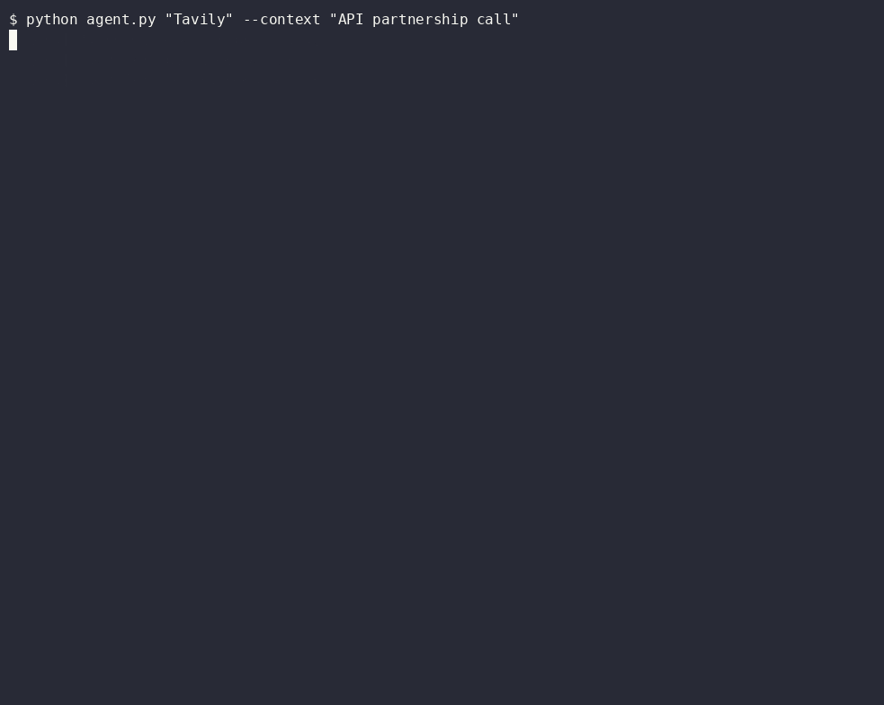

# Meeting Prep Research Agent

Walk into every meeting already knowing who you are talking to.

Give this agent a company or a person, and in under a minute it researches
them on the live web with the **Tavily API** and writes a one-page markdown
briefing: what they do, what happened with them in the last month, who the
key people are, and the sources behind every claim.

Built for the **Geek Room Global AI Hackathon** (Tavily track: meeting
research agent theme).

## Demo

A real run of the agent, recorded in the terminal (about 40 seconds):



[Watch the MP4 version](demo.mp4) · the raw terminal recording is
[demo.cast](demo.cast) (asciinema), produced by [demo-run.sh](demo-run.sh).

## The problem

Sales calls, partnership talks, client meetings and interviews all go
better when you did your homework. But real homework takes 30 to 60 minutes
of searching, opening tabs and skimming pages, so most people skip it and
walk in cold.

## What the agent does

1. **Plans** three research passes for the subject you give it:
   an overview pass, a recent-news pass (last 30 days), and a key-people pass.
2. **Searches** the live web for each pass with the Tavily Search API
   (advanced depth for the overview, news topic for developments).
3. **Synthesizes** the results into a single structured brief with a
   snapshot, recent developments, key people, source highlights and a full
   source list, so every statement can be checked against its origin.
4. **Suggests questions to ask** in the meeting, driven by the meeting
   context first and the research second — a sales call and a job
   interview with the same company get different questions. Give the
   context in structured form — the 5W (`--relationship`,
   `--agenda`, `--when`, `--where`, `--why`) plus `--purpose`,
   `--offering`, `--goal` — or
   as free text (`--context`). With no context at all, the brief does
   not print generic questions: it asks for the context instead
   (clarify-first). Nothing is invented either way — context questions
   quote your own words, headline questions quote real headlines.

No LLM key is needed. The synthesis is deterministic: it composes Tavily's
own answer summaries and ranked source excerpts, which keeps the brief
fast, cheap (3 Tavily searches per brief) and free of invented facts.

## Quick start

You need Python 3.9+ and a Tavily API key (free tier available at
https://tavily.com). There are no third-party dependencies; the agent uses
only the Python standard library.

```bash
git clone https://github.com/ahk1542001-wq/meeting-prep-research-agent.git
cd meeting-prep-research-agent
cp .env.example .env        # then paste your Tavily key into .env
python agent.py "Acme Corp"
```

Or pass the key through the environment:

```bash
export TAVILY_API_KEY=tvly-...
python agent.py "Acme Corp" --context "partnership discussion"
```

For the sharpest questions, give the meeting context in structured
form — the questions are built from it:

```bash
python agent.py "Acme Corp" --relationship "a prospective client" \
    --agenda "a first demo" --when 2026-11-25 --where "online" \
    --why "they asked to see it" --purpose sales \
    --offering "our onboarding service" --goal "a paid pilot"
```

The context is organised as the **5W**, plus your side of the
meeting:

- **Who** — the subject (the command argument) and
  `--relationship`: who they are to you (a prospective client, a
  partner, an employer)
- **What** — `--agenda`: what this specific meeting is for
- **When** — `--when`: the meeting date
- **Where** — `--where`: the place (in person or online, and where)
- **Why** — `--why`: why this meeting is happening — who called
  it, and why now

Your side: `--purpose` is the meeting type (sales, partnership,
interview, client, or your own words), `--offering` is what you
want to present or propose, and `--goal` is the outcome you want.
Any subset helps; run interactively with no context and the agent
asks for all eight fields before it starts.

The date does real work: a meeting within a week narrows the news
search to the last week instead of the last month, and a meeting
within three days adds a question about which fresh development is
most likely to come up first.

The brief is printed to the terminal and saved as `brief-<subject>.md`.

## Example

```bash
$ python agent.py "Tavily" --context "API partnership call"

[agent] Planning research on: Tavily
[agent] Step 1/3: overview search
[agent] Step 2/3: recent news search
[agent] Step 3/3: key people search
[agent] Writing the brief
[agent] Done. Brief saved to brief-tavily.md
```

The generated brief looks like this (structure):

```markdown
# Meeting Prep Brief: Tavily
_Researched on 2026-11-15 with the Tavily API._
_Meeting context: API partnership call_

## Snapshot
<what the company does, in a short paragraph>

## Recent developments (last month)
<the latest news summary, plus the top 3 stories with links>

## Key people
<founders and leadership, with roles>

## Source highlights
<ranked excerpts from the strongest sources>

## All sources
<numbered list of every URL used>

## Questions to ask
<3-5 questions built from your meeting context and the findings above>
```

Full real briefs generated by the agent are committed as examples —
the subject can be a company or a person, and the two examples use
different meeting contexts on purpose, so the questions differ:

- [brief-example.md](brief-example.md) — company: **Tavily**
  (structured context: partnership, presenting meeting-prep tooling,
  goal of an API partnership)
- [brief-example-person.md](brief-example-person.md) — person:
  **Satya Nadella** (structured context: interview, presenting an
  AI-agent building background, goal of an AI product role)

## Why Tavily

- `include_answer` gives a grounded summary for each research pass, so the
  brief can be composed without an extra LLM call.
- The `news` topic plus `time_range` keeps the developments section
  actually recent instead of evergreen.
- Ranked results with content snippets make source highlights and the
  audit trail trivial to build.

## Roadmap

- Optional LLM polish pass for narrative talking points.
- Deeper people mode: a named individual already works as a subject
  (see the person example above); a dedicated pass for role history,
  public posts and shared connections would sharpen it further.
- n8n version: trigger from a calendar event and deliver the brief to
  Telegram or email 30 minutes before each meeting.

## Author

Victor — AI automation builder (n8n, AI agents), Bangkok.
GitHub: https://github.com/ahk1542001-wq

## License

MIT
